# Wincraft – how the game works

Each block below is a standalone Mermaid diagram. Paste one (without the
```` ```mermaid ```` fence) into https://mermaid.live to view or edit it, or open
this file in a Markdown preview that renders Mermaid (GitHub, VS Code with a
Mermaid extension).

1. Big picture: scenes, scripts and native classes
2. Startup
3. One frame
4. Controls: keys to tools
5. Sculpting decision (`_sculpt`)
6. Selection, transform and copy/paste
7. Undo / redo
8. Physics bodies, balls and the frog
9. Rendering pipeline
10. Object editor
11. Baking the frog

---

## 1. Big picture

`game.tscn` just instances `world.tscn`. Nearly all gameplay is in `world.gd`
(GDScript glue and tools) calling into the C++ extension (`gdextension/src`),
which does the heavy lifting: voxel storage, sculpting, physics and the data
the raymarching shader draws.

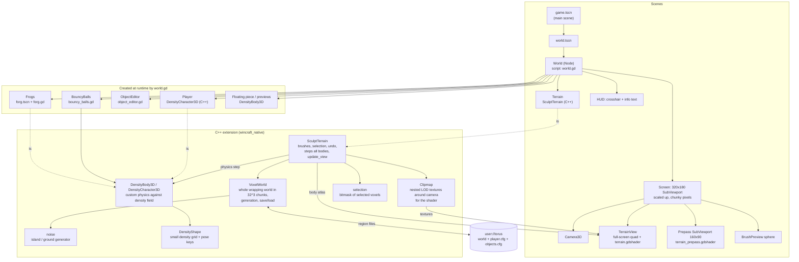

---

## 2. Startup (`world.gd _ready`)

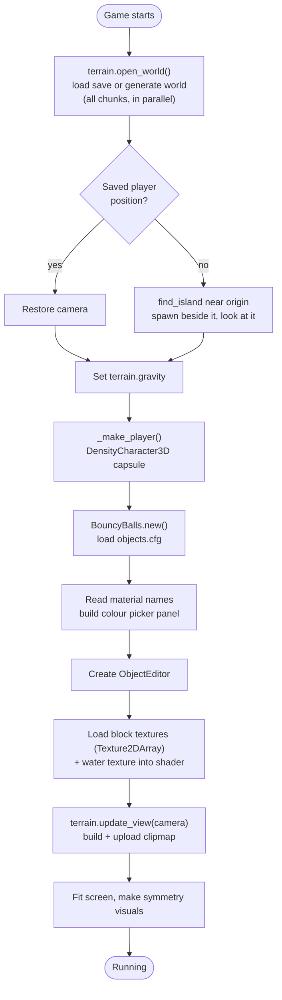

---

## 3. One frame

Godot calls these in order each frame. Physics runs at a fixed rate; the
terrain node steps every body after `world.gd` moves the player.

```mermaid
flowchart TD
    subgraph "_input (per event)"
        I0{"ObjectEditor.handle_input<br/>took it?"} -- yes --> Iend([done])
        I0 -- no --> I1["Mouse move: yaw / pitch camera"]
        I0 -- no --> I2["Mouse button: capture mouse, physics gun,<br/>box/geometry clicks, gizmo, middle-click pick,<br/>wheel = radius / strength / size"]
        I0 -- no --> I3["Keys: tools, undo/redo, copy/paste,<br/>spawn ball/frog, symmetry, ..."]
    end

    subgraph "_physics_process (fixed rate)"
        P1["_wrap_player()<br/>shift everything by world size<br/>when past half-way"] --> P2["balls.stream()<br/>load / unload far balls"]
        P2 --> P3["WASD + sprint + jump<br/>-> player.velocity, gravity"]
        P3 --> P4["player.move_and_slide()<br/>(against density field)"]
        P4 --> P5["_update_physics_gun()"]
        P5 --> P6["SculptTerrain._physics_process<br/>DensityBody3D.step_all():<br/>gravity, terrain contacts,<br/>body-body contacts, sleep"]
        P6 --> P7["forg.gd _physics_process<br/>(each frog decides hops)"]
    end

    subgraph "_process (every rendered frame)"
        R1["Camera follows player eye<br/>(eased on small steps)"] --> R2["_sculpt(delta)<br/>see diagram 5"]
        R2 --> R3["_update_gizmo / _update_geometry / _update_box"]
        R3 --> R4["_record_history()<br/>see diagram 7"]
        R4 --> R5["terrain.update_view(camera)<br/>move clipmap, upload changes,<br/>send drawn bodies, autosave"]
        R5 --> R6["Sync prepass camera"]
        R6 --> R7{"30 s passed?"}
        R7 -- yes --> R8["Save player + objects"]
    end
```

---

## 4. Controls: keys to tools

```mermaid
flowchart LR
    subgraph "Number keys (repeat to cycle)"
        k1["1"] --> Draw & Inflate
        k2["2"] --> Smooth & Pinch
        k3["3"] --> Flatten
        k4["4"] --> Grab
        k5["5"] --> SnakeHook["Snake hook"]
        k6["6"] --> Paint
        k7["7"] --> SelPaint["Select paint"] & SelFill["Select fill"] & SelGeo["Select geometry"]
        k8["8"] --> Extrude & Transform
        k9["9"] --> Gun["Physics gun"]
        k0["0"] --> Geometry & Box & BoxCut["Box cut"]
    end

    subgraph "Other keys"
        F["F: throw ball"]
        G["G: drop frog"]
        X["X: remove aimed body"]
        P["P: selection -> physics object"]
        B["B: blocky mode"]
        Br["[ ]: material"]
        Tab["Tab: colour picker"]
        EQZ["E / Q / Z / + -: symmetry"]
        M["M: object editor"]
        T["T: gizmo move/rotate/scale"]
        Ent["Enter: confirm (Shift = cut)"]
        Bs["Backspace: clear / cancel"]
        CZ["Ctrl+Z / Ctrl+Shift+Z: undo / redo"]
        CC["Ctrl+C / Ctrl+V: copy / paste"]
        CP["Ctrl+P / Ctrl+O: export / import shape"]
        KL["K / L / Shift+wheel: player size"]
    end
```

---

## 5. Sculpting decision (`_sculpt`, every frame)

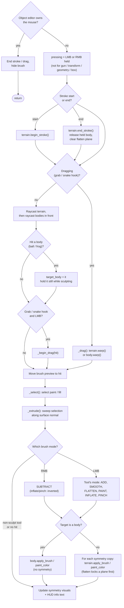

---

## 6. Selection, transform and copy/paste

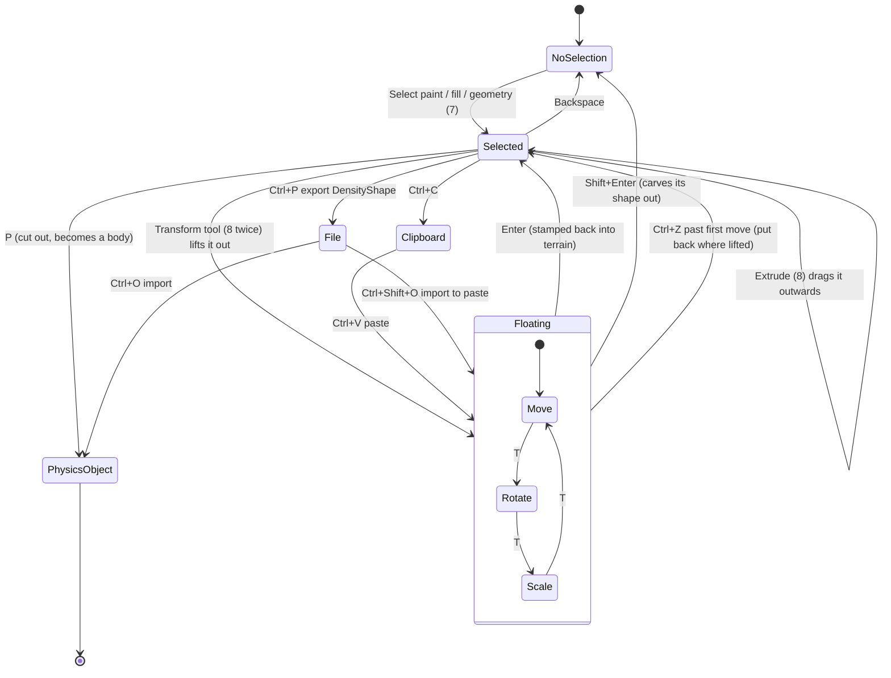

Geometry (0) and Box (0 twice / three times) work similarly: place points or
corners with clicks, preview a `DensityBody3D`, then Enter stamps it into the
terrain (Shift+Enter or Box cut carves it out). Select geometry selects the
ground inside it instead.

---

## 7. Undo / redo

The terrain keeps its own undo stack in C++; `world.gd` keeps a combined
history that interleaves terrain steps with body sculpts, selection changes
and moves of the floating piece.

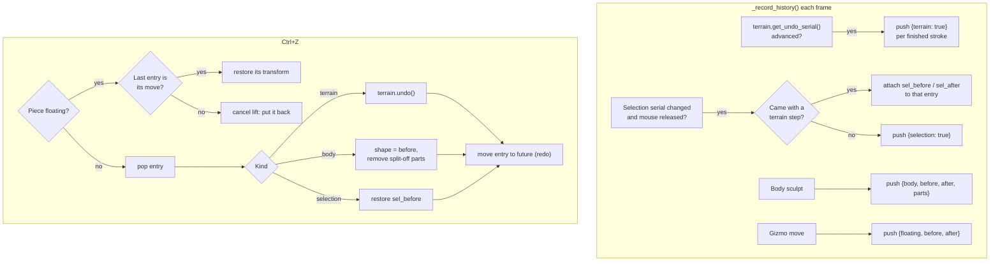

---

## 8. Physics bodies, balls and the frog

No Godot physics is used. Every body collides by sampling the terrain's
density field (roughly the signed distance to the surface) with spheres.

```mermaid
flowchart TD
    subgraph Kinds["Kinds of DensityBody3D"]
        K1["Player: DensityCharacter3D<br/>capsule of spheres, frozen,<br/>moved by move_and_slide"]
        K2["Ball: DensityShape.make_sphere<br/>(bouncy_balls.gd)"]
        K3["Physics object: shape from<br/>selection (P) or import"]
        K4["Frog: forg.tscn<br/>shape with pose keys"]
    end

    subgraph Step["DensityBody3D.step_all (once per physics frame)"]
        S1["Skip sleeping / frozen bodies"] --> S2["Split into substeps<br/>(no tunnelling)"]
        S2 --> S3["Integrate gravity + velocity"]
        S3 --> S4["Each probe sphere:<br/>depth = r + density(centre)"]
        S4 --> S5{"Touching ground<br/>or another body?"}
        S5 -- yes --> S6["Push out along gradient,<br/>bounce impulse, friction"]
        S5 -- no --> S9
        S6 --> S9{"Slow for a while<br/>while touching?"}
        S9 -- yes --> S10["Sleep until an edit<br/>or hit wakes it"]
    end

    subgraph Balls["bouncy_balls.gd"]
        B1["F: throw ball"] --> B2["stream(): unload > 512 away,<br/>reload < 448"]
        B2 --> B3["Fell out of world: break"]
        B2 --> B4["Saved to objects.cfg"]
    end

    subgraph Frog["forg.gd AI (each physics frame)"]
        F1["Every 4-10 s: pick a<br/>random direction"] --> F2{"On ground and<br/>not facing it?"}
        F2 -- yes --> F3["Every 0.6 s: small hop<br/>+ turn towards it"]
        F2 -- yes --> F4["Every 10-15 s: big leap<br/>forward + up"]
        F3 & F4 --> F5["AnimationTree: idle / jump_start / jump<br/>animates the shape's 'pose'"]
    end
```

---

## 9. Rendering pipeline

There are no terrain meshes. A full-screen quad runs a raymarching shader
over 3D textures that mirror the voxel data near the camera.

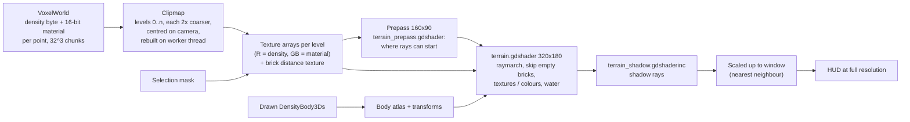

---

## 10. Object editor (`object_editor.gd`, press M on a body)

The body is frozen and the world's normal tools sculpt and paint it. A
shape's pose keys are like a mesh's shape keys: `pose` blends between them,
and the timeline animates `pose`.

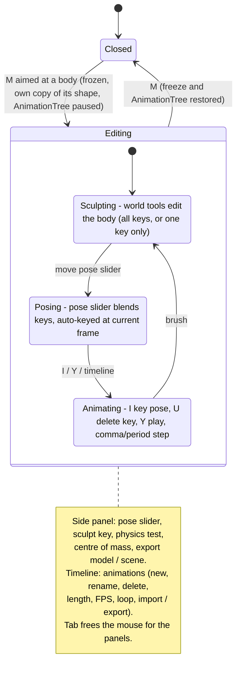

---

## 11. Baking the frog (offline tool, `bake_frog.gd`)

Run from a terminal with `--headless --script bake_frog.gd` after editing the
model in Blender.

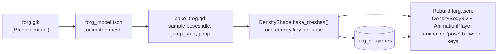
